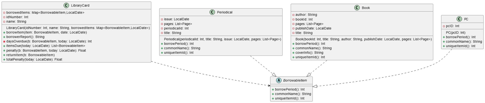

# Lab Exercise 7: Borrowing from the Library (Kotlin)

Implement the borrowing and returning functions of a library system based on the class diagram below.

## UML Class Diagram

## Existing Classes

### `BorrowableItem`

An interface representing something from the library that can be borrowed, containing the following abstract functions:

- `uniqueItemId(): Int` — returns a unique identifier for the specific `BorrowableItem` instance.
- `commonName(): String` — returns a string representation of the common name of a given `BorrowableItem` instance.

### `Book`

A realization of `BorrowableItem` representing a book, constructed with:

- `bookId: Int` — unique identifier for the book
- `title: String` — title of the book
- `author: String` — author of the book
- `publishDate: LocalDate` — date the book was published
- `pages: List<Page>` — list of `Page`s representing the book's contents

### `Page`

A simple data holder representing a page in a book or periodical.

### `LibraryCard`

Represents a library card containing borrower information:

- `idNumber: Int` — unique identifier for the borrower
- `name: String` — name of the borrower
- `borrowedItems: MutableMap<BorrowableItem, LocalDate>` — maps borrowed items to their borrow date (`java.time.LocalDate`)
- `borrowItem(item: BorrowableItem, date: LocalDate)` — adds a new entry in `borrowedItems`
- `borrowerReport(): String` — returns a borrower report including the borrower's name and the list of borrowed items with each item's borrow date

## Requirements

### `Periodical`

A realization of `BorrowableItem` representing a newspaper, magazine, etc.:

- Primary constructor: `Periodical(periodicalId: Int, title: String, issue: LocalDate, pages: List<Page>)`
- `issue: LocalDate` — publish date of the periodical
- `pages: List<Page>` — contents of the periodical
- `periodicalId: Int` — unique ID of the periodical
- `title: String` — title of the periodical (e.g., `"National Geographic"`, `"New York Times"`)
- `commonName(): String` — returns the title and issue date in `year-month-day` format (e.g., `"National Geographic issue: 2001-4-6"`)
- `uniqueItemId(): Int` — returns `periodicalId`

### `PC`

A realization of `BorrowableItem` representing a borrowable PC unit in the library:

- Primary constructor: `PC(pcID: Int)`
- `pcID: Int` — unique ID for the PC
- `commonName(): String` — returns `"PC"` followed by `pcID` (e.g., `"PC1342"`)
- `uniqueItemId(): Int` — returns `pcID`

### `LibraryCard` Methods

| Method | Description |
| ------ | ----------- |
| `returnItem(b: BorrowableItem)` | Removes `b` from `borrowedItems`. |
| `penalty(b: BorrowableItem, today: LocalDate): Float` | Calculates the overdue penalty for `b` as of `today`. Each day after the due date adds `3.5` (e.g., 4 days overdue = `14.0`). |
| `itemsDue(today: LocalDate): List<BorrowableItem>` | Returns all borrowed items on or past their due date (`Book`: 7 days, `Periodical`: 1 day, `PC`: 0 days). |
| `totalPenalty(today: LocalDate): Float` | Returns the total penalty across all overdue items as of `today`. |

## Assessment Criteria

- Completeness of `BorrowableItem` attributes and methods — **20**
- Completeness of `LibraryCard` methods — **20**

## Files

- [`solution.kt`](./solution.kt) — library borrowing domain classes and `LibraryCard` implementation
- [`main.kt`](./main.kt) — debug runner (`debugMain`)
