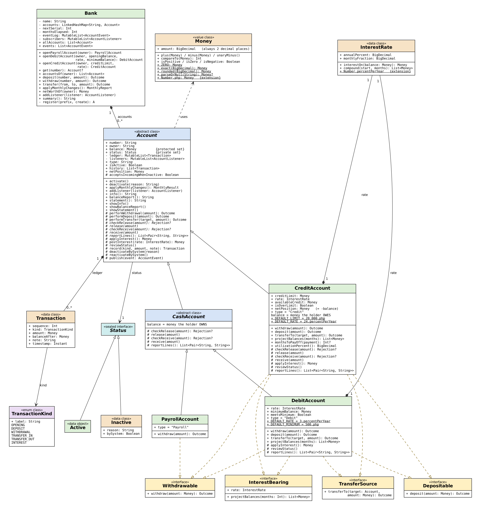
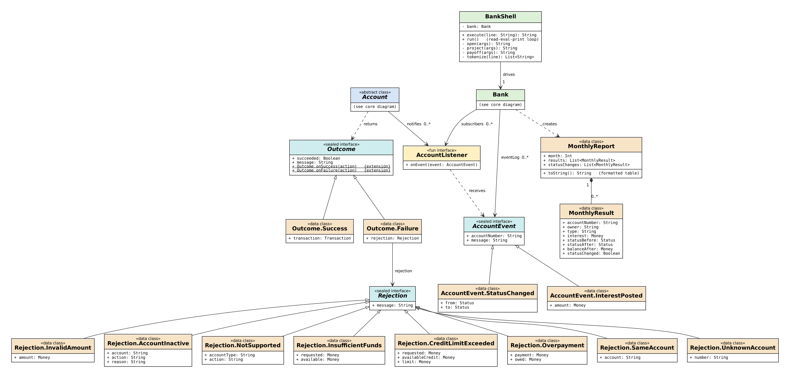

# Lab Exercise 8: Designing an OOP System — Banking System (Kotlin)

Design and implement an object-oriented banking system in Kotlin, accompanied by UML class diagrams representing the system architecture.

## Reference Materials

- [Kotlin Introduction](https://howdoigithelp.github.io/CMSC23MDNotes/designing-an-oop-system/kotlin-introduction)
- [OOP Kotlin Notes](https://howdoigithelp.github.io/CMSC23MDNotes/oop-kotlin)
- [OOP Kotlin Video](https://www.youtube.com/watch?v=CiUicGm5f7s&list=PLWQOTeFPeCeuh9Eylf2qUsgqZ1bhZfxav&index=12)
- [UML for Class Diagrams](https://howdoigithelp.github.io/CMSC23MDNotes/uml-for-class-diagrams)
- [Exceptions](https://howdoigithelp.github.io/CMSC23MDNotes/designing-an-oop-system/exceptions)

## Requirements

### Account Types

- **Payroll** — can withdraw funds and receive funds from transfers, but cannot deposit or initiate transfers.
- **Debit** — can withdraw, deposit, and transfer funds to any account. Balance compounds monthly based on an interest rate. Maintains a required minimum balance; failing to meet it deactivates the account.
- **Credit** — can withdraw (increasing the credit balance owed), deposit (deducting from the credit balance), and transfer funds to any account (increasing the credit balance), subject to a credit limit. Credit balance compounds monthly based on an interest rate.

### System Features

- **Monthly Account Changes** — compounds debit and credit balances based on interest and updates account active/inactive statuses when triggered.
- **Fund Transfers** — transfers funds to any account type while preventing debit overdrafts and credit limit breaches.
- **Activation & Deactivation** — activate and deactivate accounts.
- **Withdrawals** — disallows withdrawals exceeding available balance or credit limit.
- **Deposits** — supported for debit and credit accounts (disallowed for payroll accounts).
- **Balance Report** — displays the balance report for an account.
- **Account Information** — displays account owner name, account type, and active/inactive status.

## UML Diagrams

### Core Design



### Results and Events



## Project Structure

- [`src/Money.kt`](./src/Money.kt) — `Money` value class backed by `BigDecimal` (2 decimal places)
- [`src/Results.kt`](./src/Results.kt) — `Outcome`, `Rejection` sealed hierarchy, account status, transaction entries, events, and monthly reports
- [`src/Accounts.kt`](./src/Accounts.kt) — capability interfaces (`Withdrawable`, `Depositable`, `TransferSource`, `InterestBearing`), base `Account`, and `PayrollAccount`, `DebitAccount`, `CreditAccount`
- [`src/Bank.kt`](./src/Bank.kt) — `Bank` aggregate coordinating account creation, transfers, monthly runs, and event notifications
- [`src/BankShell.kt`](./src/BankShell.kt) — interactive CLI shell for operating the bank
- [`src/Main.kt`](./src/Main.kt) — scripted demo tour and `--shell` entrypoint
- [`uml/`](./uml/) — SVG and PNG UML diagrams

## Running

```bash
kotlinc src/*.kt -include-runtime -d banking-system.jar
java -jar banking-system.jar          # run scripted demo
java -jar banking-system.jar --shell  # run interactive shell
```
